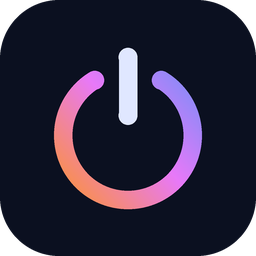

# Dusk

Een kleine, lichte app voor Windows 11 om je pc af te sluiten, in slaapstand of sluimerstand te zetten of opnieuw op te starten. Met een sneltoets en je pijltjestoetsen, en een timer als je wilt.



## Downloaden

Kijk bij **Releases** en kies `Dusk-Setup.exe`. De installer heeft geen beheerdersrechten nodig.

## Gebruik

- **Openen:** klik op het icoon bij de klok (venster rechtsonder), of `Win + Shift + Q` en het startmenu (venster in het midden). Waar hij opent kies je in Instellingen, ook "waar ik hem neerzet": versleep het venster aan de bovenkant.
- **Kiezen:** pijltjes omhoog en omlaag, of de cijfers 1 tot 4.
- **Wanneer:** standaard *Nu*. Met `+` en `−` gaat er 15 minuten bij of af, met links en rechts kies je een vaste tijd (15 min, 30 min, 1 uur, 2 uur). Met de `+`-knop in die rij maak je je eigen vaste tijd; rechtsklik om er een weg te halen.
- **Zelf een tijd kiezen:** klik op het tijdvak, of druk `Tab`. Kies *Over* (bijvoorbeeld over 1 uur 30) of *Om* (bijvoorbeeld om 23:30) met twee wieltjes: scrollen, pijltjes, of gewoon de cijfers typen.
- **Uitvoeren:** `Enter` of de knop onderaan. Boven de knop staat precies wat er gaat gebeuren. Bij *Nu* telt Dusk eerst af (standaard 10 seconden, in te stellen), zodat je op het laatste moment nog met `Esc` kunt stoppen.
- **Timer loopt:** het icoon in de taakbalk dooft langzaam uit. Een minuut van tevoren krijg je een melding met *+15 min* en *Annuleren*.
- **Instellingen:** het tandwiel, `Ctrl + ,` of rechtsklik op het icoon. Taal (Nederlands, English, Español, Français), licht of donker, achtergrond (Mica, effen, schemer), accentkleur, sneltoets en meer.

## Vanaf een toets, muis of Stream Deck
Start `Dusk.exe` nog een keer en het venster verschijnt (nog een keer: het verdwijnt). Dat werkt met elke knop die een programma kan openen, zoals "Programma openen" in Logi Options+.
Je kunt ook meteen een actie meegeven; dan begint het gewone aftellen:

`Dusk.exe --slaapstand`, `--sluimerstand`, `--herstarten`, `--afsluiten`, `--vergrendelen`, `--afmelden`, `--wisselen`

Dusk staat in `%LOCALAPPDATA%\Programs\Dusk\Dusk.exe`.

Let op: de vergrendeltoets van een toetsenbord (het slotje) stuurt Windows + L. Die combinatie handelt Windows zelf af voordat een programma er iets mee kan, dus omzetten werkt daar niet betrouwbaar. Kies een andere toets.

## Bijwerken

Nieuwe versies installeer je met een klik bij **Instellingen > Bijwerken**. Dusk kijkt zelf af en toe of er iets nieuws is en meldt het dan (uit te zetten). Het bestand wordt gecontroleerd voordat het wordt geïnstalleerd.

## Goed om te weten

- Afsluiten gaat netjes: programma's met werk dat nog niet is opgeslagen mogen eerst vragen of je wilt opslaan. Geforceerd afsluiten kan in Instellingen.
- Slaapt je pc terwijl er een timer loopt en is de tijd voorbij als hij wakker wordt, dan voert Dusk de actie niet alsnog uit. Hij stopt de timer en meldt dat.
- Pc's met *Modern Standby* (veel laptops) gaan in slaapstand zoals het startmenu het doet.
- Dusk werkt helemaal offline. Instellingen en een klein logboek staan in `%APPDATA%\Dusk`.

## Zelf bouwen

Op Windows, zonder iets te installeren (de C#-compiler van .NET Framework 4.8 zit in Windows):

```
powershell -ExecutionPolicy Bypass -File build\build.ps1
```

GitHub Actions bouwt bij elke push, draait de tests, maakt schermafbeeldingen van alle schermen (tak `zelftest-schermen`) en de installer. Staat er een nieuw versienummer in `src/Program.cs`, dan komt er vanzelf een Release.

## Licentie

MIT, zie `LICENSE`.
